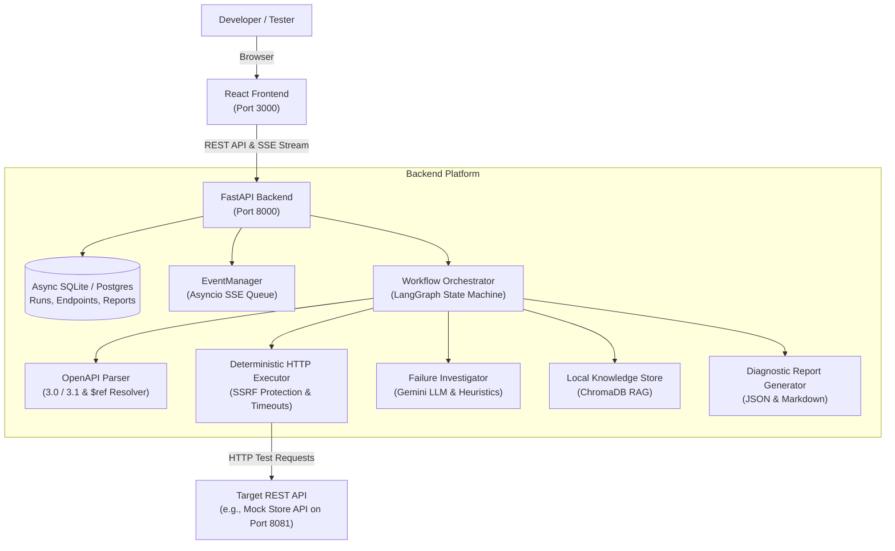

# Autonomous REST API Testing and Failure Investigation Agent

An automated testing platform that reads an OpenAPI specification, executes tests against a target REST API, and investigates failures to identify the root cause instead of just reporting a failing status code.

---

## 1. The Problem We Are Trying to Solve

Testing REST APIs is usually repetitive and time-consuming:
1. Developers or QA engineers have to write test cases by hand for every single endpoint.
2. When an API changes, old tests break or miss new edge cases.
3. Most automated tools only check if the HTTP status code matches. If an endpoint returns `500 Internal Server Error`, the tool marks it as "FAILED" without explaining why it failed or what input triggered the bug.
4. Debugging requires manually digging through server logs, re-sending requests with modified parameters, and guessing the root cause.

Our goal is to build an intelligent assistant that does this repetitive work automatically: it understands the API contract from the OpenAPI document, plans and runs tests, and when a failure occurs, runs follow-up experiments to explain the root cause and suggest how to fix it.

---

## 2. What Our Project Does (In Simple Steps)

```
[1. Upload Spec]  -->  [2. Parse Endpoints]  -->  [3. Run Tests]  -->  [4. Investigate Bugs]  -->  [5. View Report]
  OpenAPI YAML/JSON       Extract paths & inputs     HTTP executor         LLM reasoning & retests    Web dashboard & export
```

1. **Reads the API Spec**: You upload an OpenAPI 3.0 or 3.1 file (YAML or JSON). The parser extracts all endpoints, methods, parameters, and request body schemas.
2. **Generates Tests**: The agent generates valid inputs, boundary conditions (such as 0 or negative numbers), and invalid inputs to test both happy paths and error handling.
3. **Executes Requests Safely**: A safe HTTP executor sends requests to the target API with timeouts and Server-Side Request Forgery (SSRF) protection.
4. **Investigates Failures**: When an endpoint returns an unexpected error (like an unhandled 500 error instead of a 400 validation error), the agent analyzes the response body, headers, and API documentation to classify the defect.
5. **Retests and Pinpoints the Bug**: The agent sends follow-up requests with slightly modified parameters (parameter variations) to confirm what specific value causes the failure.
6. **Produces a Diagnostic Report**: The results are saved and displayed on a clean web dashboard, complete with pass rates, evidence, and exportable JSON and Markdown files.

---

## 3. Main Features

- **OpenAPI Ingestion**: Supports OpenAPI 2.0, 3.0, and 3.1 in both YAML and JSON format. Handles circular and nested `$ref` schema references.
- **SSRF Network Protection**: Blocks accidental or malicious requests to private IP ranges (`127.0.0.1`, AWS metadata endpoints, internal subnets) during live tests, with a configurable safe development mode for local mock APIs.
- **LangGraph Agent Workflow**: Uses a stateful graph to control the testing lifecycle (planning &rarr; execution &rarr; assertion check &rarr; failure investigation &rarr; parameter variation &rarr; report compilation).
- **Real-Time Live Telemetry (SSE)**: Streams live progress events to the browser using Server-Sent Events, so you can watch each endpoint transition from pending to running to passed/failed in real time.
- **Local Knowledge Store (RAG)**: Integrates ChromaDB with semantic search over API error patterns and troubleshooting guidelines.
- **Diagnostic Reports**: Generates clear executive summaries, detailed request/response logs, and remediation guidance, downloadable in JSON or Markdown.
- **Controlled Mock API**: Includes a built-in FastAPI mock store with intentional defects (such as an unhandled 500 error when sending a negative price) for safe offline testing and grading.

---

## 4. Technologies Used and Why

| Technology | Role | Why We Chose It |
|---|---|---|
| **Python 3.10+ & FastAPI** | Backend API | Fast asynchronous web framework with automatic OpenAPI docs and native support for Server-Sent Events (SSE). |
| **SQLAlchemy 2.0 & SQLite / PostgreSQL** | Database Layer | Dual database support: runs on zero-configuration SQLite for local development and supports PostgreSQL for production. |
| **LangGraph & LangChain** | Agent Orchestration | Provides a structured state-machine graph for cyclic testing, retesting, and controlled loop limits. |
| **Google Gemini API** | LLM Reasoning | Fast response times and structured Pydantic output capabilities for analyzing error payloads and generating fixes. |
| **ChromaDB** | Local Vector DB | Lightweight embedded vector database for local Retrieval-Augmented Generation (RAG) without external server setup. |
| **HTTPX** | HTTP Client | Modern async HTTP client supporting custom transports, streaming limits, and deterministic timeouts. |
| **React 18, TypeScript & Vite** | Frontend Dashboard | Clean component-based UI with fast development reload and type safety. |
| **TanStack React Query** | Frontend Data Sync | Handles caching, loading states, and background refetching cleanly without manual Redux boilerplate. |
| **Tailwind CSS** | Styling | Utility-first styling that creates a responsive and readable dashboard without heavy external UI dependencies. |

---

## 5. System Architecture



---

## 6. Project Folder Structure

```
Agent Project/
├── backend/
│   ├── app/
│   │   ├── agent/           # LangGraph nodes (planning, evaluation, investigation)
│   │   ├── api/             # FastAPI routers (v1: projects, runs, reports)
│   │   ├── core/            # Config, database engine, events, SSRF security
│   │   ├── models/          # SQLAlchemy 2.0 database tables
│   │   ├── repositories/    # Database CRUD operations
│   │   ├── schemas/         # Pydantic request and response schemas
│   │   ├── services/        # Business logic (ProjectService, RunService, ReportGenerator)
│   │   └── main.py          # FastAPI application entry point
│   └── requirements.txt     # Python dependencies
├── frontend/
│   ├── src/
│   │   ├── components/      # Reusable UI components (layout, runs, reports)
│   │   ├── hooks/           # Custom hooks (e.g., useRunEvents for SSE)
│   │   ├── services/        # Frontend API client
│   │   ├── views/           # Page views (Dashboard, Projects, Live Run, Report)
│   │   └── main.tsx         # React application root
│   ├── package.json         # Node.js dependencies
│   └── vite.config.ts       # Vite build & backend reverse-proxy config
├── mock_api/
│   ├── main.py              # Controlled mock REST API with intentional bugs
│   └── openapi.json         # Mock API OpenAPI 3.0 specification
├── docs/
│   ├── ARCHITECTURE.md      # Detailed system architecture document
│   ├── SETUP.md             # In-depth setup and troubleshooting guide
│   ├── DEMO_GUIDE.md        # Step-by-step viva & project demo walkthrough
│   └── KNOWN_LIMITATIONS.md # Current limitations and future scope
├── scripts/
│   └── verify_e2e_integration.py # Automated end-to-end integration test
├── tests/                   # Backend unit and integration test suite
├── .env.example             # Safe environment configuration template
└── README.md                # Project documentation (this file)
```

---

## 7. Installation and Setup

### Prerequisites
- **Python 3.10+**: `python3 --version`
- **Node.js 18+** & **npm**: `node -v` and `npm -v`

### 1. Set Up Python Backend
```bash
# Navigate to the project root
cd "Agent Project"

# Create and activate virtual environment
python3 -m venv venv
source venv/bin/activate

# Install backend dependencies
pip install --upgrade pip
pip install -r backend/requirements.txt
```

### 2. Set Up Frontend
```bash
cd frontend
npm install
cd ..
```

### 3. Configure Environment
```bash
cp .env.example .env
```
The default `.env` is pre-configured to use **SQLite** (`DATABASE_URL=sqlite+aiosqlite:///./api_agent.db`), so you do not need to install or run PostgreSQL for local development.

If you have a Google Gemini API key, add it to `GEMINI_API_KEY` in `.env`. If you do not have one, the platform automatically uses rule-based heuristics for failure classification.

---

## 8. Starting the Application

Run the application using three separate terminal windows:

### Terminal 1: Mock REST API
```bash
source venv/bin/activate
uvicorn mock_api.main:app --host 127.0.0.1 --port 8081
```

### Terminal 2: FastAPI Backend
```bash
source venv/bin/activate
uvicorn backend.app.main:app --host 127.0.0.1 --port 8000
```
*Tip: Visit `http://127.0.0.1:8000/docs` to see the backend Swagger documentation.*

### Terminal 3: React Frontend
```bash
cd frontend
npm run dev
```
Open **`http://localhost:3000`** in your browser.

---

## 9. How to Run a Complete Demo

1. Open `http://localhost:3000` in your web browser. Check that the top header shows a green **Backend Connected** badge.
2. In the sidebar, click **Projects** and then click **New Project**.
3. Choose **Upload File** and select `mock_api/openapi.json` from the repository root (or paste its content).
4. Enter `Mock Store API` as the name and click **Create Project**.
5. The project details page will open, showing all 7 extracted endpoints (`GET /api/health`, `POST /api/products`, etc.).
6. Click **Start Test Run** in the top right corner, choose a concurrency value (e.g. 2), and confirm.
7. The page redirects to `/runs/:id`. You will see the **Live** connection badge and real-time event updates as each endpoint is tested.
8. When the run finishes, click **View Diagnostic Report** to inspect the executive summary, pass rates, and individual operation details.
9. Click **Export JSON** or switch to the **Markdown Preview** tab to download the final report.

*(For detailed viva talking points, check [docs/DEMO_GUIDE.md](docs/DEMO_GUIDE.md).)*

---

## 10. Running the Automated E2E Verification Script

We built a single verification script that automatically tests the entire application journey (starting servers, health check, spec upload, endpoint extraction, test run, live SSE stream, report generation, negative paths, and cascade deletion):

```bash
source venv/bin/activate
python scripts/verify_e2e_integration.py
```

Expected output:
```
[PASS] Step 1: Start application servers
[PASS] Step 2: Backend health and frontend connectivity
[PASS] Step 3: OpenAPI spec upload & project creation
[PASS] Step 4: Project details & extracted endpoints
[PASS] Step 5: Start test execution run
[PASS] Step 6: Live SSE execution telemetry
[PASS] Step 7: Diagnostic report verification
[PASS] Step 8: Report export (JSON & Markdown)
[PASS] Step 9: Failure path verification
[PASS] Step 10: Project deletion & cascade verification
```

---

## 11. Important API Endpoints

The backend provides standard REST endpoints under `/api/v1`:

| Method | Endpoint | Description |
|---|---|---|
| `GET` | `/health` | Backend health check and environment status |
| `POST` | `/api/v1/projects` | Upload OpenAPI spec and create project with endpoints |
| `GET` | `/api/v1/projects` | List all projects with endpoint counts |
| `GET` | `/api/v1/projects/{id}` | Get project details and all extracted endpoints |
| `DELETE` | `/api/v1/projects/{id}` | Delete a project and cascade-delete all its runs |
| `POST` | `/api/v1/projects/{id}/runs` | Start a new test execution run (HTTP 202) |
| `GET` | `/api/v1/projects/{id}/runs` | List all test runs for a project |
| `GET` | `/api/v1/runs/{id}` | Get status and timings of a specific run |
| `POST` | `/api/v1/runs/{id}/cancel` | Request cooperative cancellation of an active run |
| `GET` | `/api/v1/runs/{id}/events` | Subscribe to live Server-Sent Events (SSE) stream |
| `GET` | `/api/v1/runs/{id}/report` | Retrieve diagnostic report (`format=json` or `format=markdown`) |

---

## 12. Current Limitations

- **Single-Process SSE Broker**: The live progress stream currently uses an in-memory `asyncio.Queue`. In a multi-worker production deployment, an external broker like Redis Pub/Sub would be required.
- **SQLite Concurrency**: SQLite locks the database during writes. For high-volume multi-user deployments, switching `DATABASE_URL` to PostgreSQL is recommended.
- **Specification Scope**: Currently targets REST APIs with OpenAPI 2.0, 3.0, and 3.1. Non-REST protocols (GraphQL, gRPC, SOAP) are not supported.
- **Authentication**: Supports Bearer tokens, API keys, and custom headers. Complex interactive flows like multi-step OAuth2 browser redirects require pre-generated tokens.

*(For an in-depth breakdown of limitations and future scope, see [docs/KNOWN_LIMITATIONS.md](docs/KNOWN_LIMITATIONS.md).)*

---

## 13. Documentation Index

- [docs/ARCHITECTURE.md](docs/ARCHITECTURE.md) — Detailed explanation of internal components and communication.
- [docs/SETUP.md](docs/SETUP.md) — Step-by-step installation, environment variables, and troubleshooting.
- [docs/DEMO_GUIDE.md](docs/DEMO_GUIDE.md) — Viva presentation guide and step-by-step demo script.
- [docs/KNOWN_LIMITATIONS.md](docs/KNOWN_LIMITATIONS.md) — Honest discussion of current limitations and future scope.
