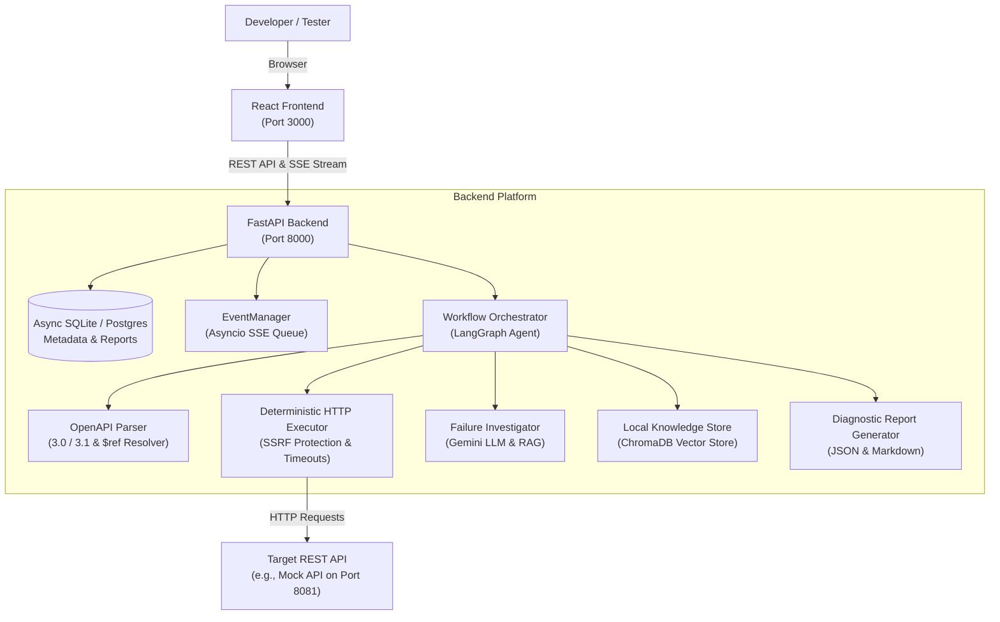

# System Architecture

This document explains how the different parts of the project work together. It is written to give you a clear, end-to-end understanding of the system's design.

---

## 1. High-Level Overview

The system is designed around a simple concept: **give the agent an OpenAPI specification, let it test the endpoints automatically, and if anything fails, investigate why it failed instead of just returning an error code.**



---

## 2. Main System Components

### 2.1 Frontend (React + TypeScript + Vite)
- **Role**: Provides a clean user interface to upload OpenAPI files, view endpoints, trigger test runs, watch real-time execution progress, and inspect diagnostic reports.
- **State Management**: Uses `@tanstack/react-query` for fetching and caching backend data.
- **Real-Time Updates**: Uses native browser `EventSource` to subscribe to the backend Server-Sent Events (SSE) stream (`/api/v1/runs/{id}/events`).
- **Styling**: Styled with Tailwind CSS without heavy UI component frameworks.

### 2.2 Backend Gateway (FastAPI)
- **Role**: Exposes REST endpoints for project management, runs, and reports.
- **Lifecycle Management**: Initializes database tables on startup (`init_db`) and cleans up resources on shutdown.
- **Dependency Injection**: Uses FastAPI dependencies (`get_db`, `get_project_service`, `get_run_service`) to keep code modular and testable.
- **Decoupled Background Tasks**: When a run is initiated, FastAPI commits the run record as `pending`, returns HTTP 202 to the user immediately, and executes the agent workflow in the background. This ensures database transactions are never held open during long network test runs.

### 2.3 Database Layer (SQLAlchemy 2.0)
- **Supported Engines**: Supports asynchronous SQLite (`sqlite+aiosqlite`) for local development and PostgreSQL (`postgresql+asyncpg`) for production.
- **Models**:
  - `Project`: Holds project details and the raw OpenAPI specification.
  - `Endpoint`: Individual parsed HTTP operations (method, path, summary).
  - `AgentRun`: Each testing run session (concurrency, status, timings).
  - `TestExecution`: Specific HTTP request/response execution records.
  - `FailureInvestigation`: Root-cause hypotheses, failure classifications, and suggested fixes.
  - `DiagnosticReport`: Pre-rendered JSON snapshots and safe GitHub-flavored Markdown.

### 2.4 OpenAPI Parser
- **Role**: Parses OpenAPI 2.0, 3.0.x, and 3.1.x specifications formatted as either YAML or JSON.
- **Reference Resolution**: Resolves circular and nested `$ref` references (e.g. `#/components/schemas/Product`) deterministically.
- **Security Check**: Enforces safe text limits to prevent file-bomb attacks.

### 2.5 Deterministic HTTP Executor with SSRF Protection
- **Role**: Sends HTTP requests generated by the agent to the target server.
- **Safety Mechanism**: Protects against Server-Side Request Forgery (SSRF) and DNS rebinding attacks. In production, requests to internal IP addresses (e.g., `127.0.0.1`, `169.254.169.254`, `10.0.0.0/8`) are blocked by default. In development mode (`SAFE_DEV_MODE=true`), local mock API hosts (`localhost`, `127.0.0.1`) are permitted.
- **Size and Time Limits**: Enforces response body size caps and request timeouts so tests never hang indefinitely.

### 2.6 LangGraph Testing & Investigation Agent
- **Workflow Graph**: Coordinates the step-by-step agent lifecycle using LangGraph:
  1. **Planning Node**: Determines which operations to test and prepares input parameters.
  2. **Execution Node**: Dispatches requests through the HTTP executor.
  3. **Assertion Node**: Compares actual responses against the OpenAPI schema and expected status codes.
  4. **Investigation Node**: If an assertion fails, classifies the error (e.g. Server Defect, Schema Violation, Authentication Error, Transient Network Error).
  5. **Retest & Variation Node**: Dispatches follow-up requests with slight parameter variations to verify whether the defect is reproducible and pinpoint the exact boundary condition.
- **Local RAG Store**: Uses ChromaDB and sentence embeddings to retrieve known troubleshooting advice and error patterns without hallucination.

### 2.7 Real-Time Event Manager (SSE)
- **Role**: A lightweight asynchronous event broker using `asyncio.Queue`.
- **Behavior**: As the agent tests operations and investigates defects, it emits structured events (`run_started`, `operation_started`, `attempt_completed`, `operation_completed`, `run_completed`).
- **Connection Handling**: Multiple browser tabs can subscribe to the same run. If a client disconnects, its queue is cleaned up without impacting other subscribers or the running agent.

---

## 3. The 4-Step Testing & Diagnosis Flow

Here is what happens during a test run:

```
[1. Upload Spec]  -->  [2. Generate & Run Tests]  -->  [3. Investigate Failures]  -->  [4. Diagnostic Report]
     OpenAPI                  HTTP Requests                  Gemini LLM + RAG                Markdown / JSON
     YAML/JSON                Deterministic Exec             Retests & Variations            Executive Summary
```

1. **Upload & Parse**: The user uploads an OpenAPI spec. The backend parses endpoints and stores them.
2. **Execute Tests**: The agent generates valid and edge-case inputs for each endpoint and sends requests.
3. **Investigate**: If an endpoint returns an unexpected code (e.g. HTTP 500 when sending a negative number), the agent retrieves context, classifies the issue, and runs targeted retests.
4. **Report**: Results are compiled into an executive summary and detailed operation logs, saved to the database, and rendered in the frontend.

---

## 4. Key Design Decisions

- **Why SQLite by default?**
  Many students and evaluators do not have a running PostgreSQL service installed. SQLite requires zero external setup and stores data in a single file (`api_agent.db`). PostgreSQL remains fully supported by changing `DATABASE_URL` in `.env`.
- **Why decoupled execution?**
  Holding a database transaction open while an agent makes 20 HTTP network requests over several seconds can lock the database and exhaust connections. The backend opens short transactions only to read or commit state, keeping network tests untransacted.
- **Why Server-Sent Events (SSE) instead of WebSockets?**
  The communication during a test run is one-way (server pushing progress events to the browser). SSE works over standard HTTP/1.1 or HTTP/2, requires no special connection upgrade, reconnects automatically, and passes easily through proxies and firewalls.
